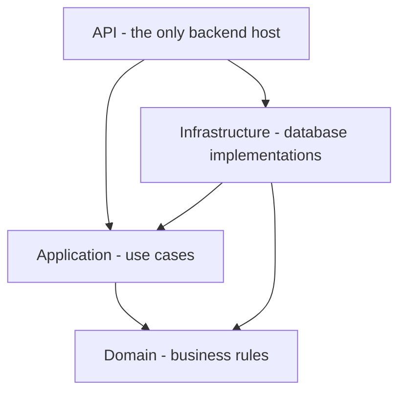
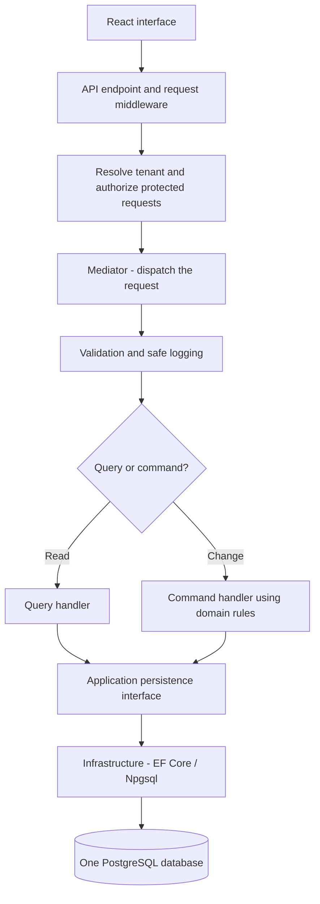
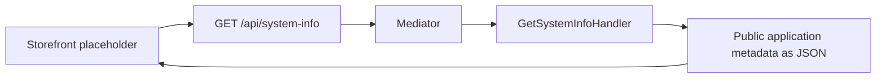
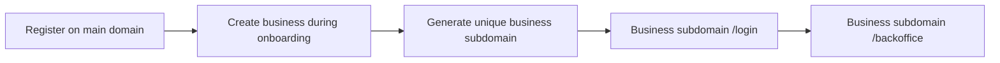

# TailorSpadi - Module 1: Project Foundation and Architecture

## Goal

Build a small, runnable foundation for TailorSpadi, a platform where tailoring businesses get their own storefront and manage online and walk-in orders.

This document is the Module 1 development prompt. Inspect existing code first and preserve working implementations. Complete and verify this module before starting Module 2.

## Technology

| Area | Choice |
|---|---|
| Architecture | Modular monolith with CQRS and the Mediator pattern |
| Backend | C#, ASP.NET Core Web API, .NET 10 |
| Frontend | React, TypeScript, Vite, Bootstrap |
| Database | PostgreSQL with EF Core and Npgsql |
| API documentation and logs | Swagger/OpenAPI and Serilog |
| Development and deployment | Visual Studio, Docker, Docker Compose |

Use React for the UI. The backend exposes APIs; do not introduce Razor, Blazor, MVC views, or jQuery.

## 1. Understand the project structure

**There is one running backend API.** The four backend projects separate code responsibilities; they are not four APIs, servers, or containers.

| Project | Responsibility | Example |
|---|---|---|
| `TailorSpadi.Api` | Receive HTTP requests and configure the application | Endpoints, middleware, `Program.cs` |
| `TailorSpadi.Application` | Execute use cases through mediator handlers | Queries, commands, validation, response DTOs |
| `TailorSpadi.Domain` | Represent business concepts and rules | Future Order entity and production rules |
| `TailorSpadi.Infrastructure` | Access PostgreSQL and external services | `AppDbContext`, EF mappings, migrations |

A DTO is a response/request data structure. A handler is the class that performs one use case. Keep Domain minimal until actual business features are introduced.

```text
TailorSpadi.sln
src/
  Backend/
    TailorSpadi.Api/
      Endpoints/
      Program.cs
      appsettings.json
    TailorSpadi.Application/
      Features/
        SystemInfo/
          GetSystemInfoQuery.cs
          GetSystemInfoHandler.cs
          SystemInfoResponse.cs
      Behaviors/                 # Shared validation and safe request logging
      Abstractions/              # Small current-user and tenant-context contracts
    TailorSpadi.Domain/           # Business entities/rules added in later modules
    TailorSpadi.Infrastructure/
      Persistence/
        AppDbContext.cs
  Frontend/
    tailorspadi-storefront/       # Customer-facing website
    tailorspadi-backoffice/       # Tailor and staff interface
    tailorspadi-admin/            # Platform administrator interface
tests/
  TailorSpadi.UnitTests/
  TailorSpadi.IntegrationTests/
compose.yaml
.env.example
README.md
```

Add future features under `Application/Features/`, such as `Catalog` and `Orders`. Keep each feature's commands, queries, handlers, validators, and DTOs together. Create folders when needed; do not scaffold every future module now.

### Project reference flowchart

An arrow means **references code in**. It does not mean an HTTP call.



Application defines the small interfaces it needs; Infrastructure implements them. API connects those implementations through dependency injection in `Program.cs`. This lets a handler use database functionality without referencing Infrastructure directly.

Domain references no other solution project. Avoid circular references, extra business-module projects, generic repositories, and custom mediator wrappers.

## 2. Understand CQRS and request flow

**Queries read data. Commands change data.** Both use the same API and PostgreSQL database.

| Query examples | Command examples |
|---|---|
| Get styles | Create a style |
| Get order details | Place an order |
| Get production progress | Update a production stage |

These business examples belong to later modules. Module 1 implements only a system-information query.

### Runtime flowchart

This shows how future business requests run, rather than project references.



The result returns through the handler and API to React as JSON. Handlers that do not need data access skip the persistence step. Public routes do not require a signed-in user; protected routes require the appropriate authorization.

Keep endpoints thin. Use a maintained mediator library such as MediatR, verifying .NET 10 compatibility and licensing before selecting it. Keep the Domain project independent of that library.

Use simple validation and logging behaviors. Do not log credentials or sensitive request bodies. Add explicit transactions when real commands need them; do not wrap every request in a transaction.

### Module 1 example



This query does not need PostgreSQL or a tenant. Return only public metadata, such as the application name. Do not invent a write feature or business tables just to demonstrate commands.

## 3. URLs and tenant routing

A tenant is one tailoring business. All businesses share the same frontend builds, API, and database.

| Purpose | URL |
|---|---|
| Platform homepage | `https://tailorspadi.com` |
| Tailor registration | `https://tailorspadi.com/register` |
| Business onboarding | `https://tailorspadi.com/onboarding` |
| Business storefront | `https://johnfashion-001.tailorspadi.com` |
| Tailor login | `https://johnfashion-001.tailorspadi.com/login` |
| Tailor backoffice | `https://johnfashion-001.tailorspadi.com/backoffice` |
| Platform administration | `https://tailorspadi.com/admin` |



Implement these account flows in Module 2. Module 1 creates only routing placeholders, small tenant/current-user contracts, and documentation.

Tenant rules for later implementation:

- Resolve the tenant from a validated hostname. Do not trust a client-supplied tenant ID.
- Verify membership and permissions for protected tenant operations. Knowing a subdomain does not grant access.
- Include `TenantId` on tenant-owned records and enforce isolation on reads and writes. Query filters alone are insufficient.
- Reject unknown tenant subdomains; do not fall back to another business.
- Keep platform administrator authorization separate from tenant authorization.
- After onboarding, redirect to the business login. Do not put authentication tokens in URLs.

Document wildcard DNS/TLS, trusted proxy headers, and local development hostnames. Full tenant resolution and authentication remain Module 2 work.

## 4. Frontend shells

Create three minimal React apps with a layout, router, and placeholder pages. Use TypeScript strict mode, React Router, Axios, TanStack Query, and Bootstrap. Add React Hook Form when actual forms are implemented.

Keep API calls in a small client module. Demonstrate `/api/system-info` in the storefront only.

| Host and path | Application |
|---|---|
| Main-domain homepage and tenant storefront pages | Storefront |
| Main-domain `/register` and `/onboarding` | Backoffice |
| Tenant `/login` and `/backoffice`, including nested routes | Backoffice |
| Main-domain `/admin`, including nested routes | Admin |
| `/api/*` | Backend API |

Document same-origin `/api` routing through a reverse proxy that preserves the validated hostname. Route API requests before frontend fallbacks. Configure app asset paths and history fallbacks so direct navigation and refresh work. A `/backoffice`-only router basename must not exclude `/login`.

Do not create separate apps per tenant or build dashboards and a shared component library now.

## 5. PostgreSQL and Docker

Use one PostgreSQL database and one `AppDbContext` in Infrastructure. Reads and writes share it.

- Verify compatible .NET, EF Core, and Npgsql versions; record chosen versions.
- Keep EF mappings and migrations in Infrastructure. Add the first business migration when business entities exist.
- Document migration commands and an explicit deployment migration step.
- Keep credentials in environment variables or development secrets; commit only placeholders.
- Follow the Nigeria date/time policy below. Use decimal money, tenant-scoped indexes, and appropriate constraints.
- Use asynchronous database access and cancellation tokens. Add a narrow persistence interface when a real handler needs it.

Create Dockerfiles and Compose services for the API, PostgreSQL, and the three React shells. PostgreSQL needs a persistent volume and health check. The class libraries are compiled into the API deployment; they have no containers of their own.

Use separate local ports initially and document the host/path proxy configuration for deployment. Keep Redis out of Module 1.

### Nigeria date and time policy

Use **Africa/Lagos (West Africa Time, WAT)** as the default business time zone. Nigeria currently uses UTC+01:00 throughout the year. Customers and staff should see Nigerian local times in screens, notifications, and reports.

| Kind of value | Storage/API convention | What users see |
|---|---|---|
| Exact event time: order created, payment received | UTC instant in PostgreSQL `timestamptz`; API ISO 8601 with `Z` | Converted to Africa/Lagos |
| Calendar date: expected delivery day | PostgreSQL `date`, .NET `DateOnly`, API `YYYY-MM-DD` | The same selected date, with no time-zone conversion |
| Appointment with a specific time | Interpret input in the business time zone, convert to UTC before persistence | Local appointment time, labelled WAT |

Example: an order created at **10:00 AM WAT** is stored as **09:00 UTC**. These represent the same moment. Database UTC storage does not mean displaying UTC to Nigerian users. PostgreSQL `timestamptz` stores the instant, not the original named time zone.

Implementation rules:

- Configure `DefaultTimeZone` as `Africa/Lagos`. When tenants are added in Module 2, give `Tenants.TimeZoneId` that default. Do not add tenant tables in Module 1.
- Format frontend times explicitly using the business time zone, for example `Intl.DateTimeFormat` with `timeZone: "Africa/Lagos"`. Do not depend on the browser or server's local zone.
- Use a UTC clock for event timestamps. Normalize offset-bearing input to UTC before passing it to Npgsql. Treat local appointment input as business-local time; never append `Z` to it without conversion.
- For future "today's orders" and daily revenue queries, calculate midnight and the next midnight in the business zone, convert both boundaries to UTC, and query `start <= timestamp < end`.
- A date-only delivery deadline becomes overdue when the business-local date moves past that day and the order remains incomplete. A deadline with a specific time uses its exact instant instead.
- Validate time-zone support in both Windows development and Linux containers. Use the named zone through platform time-zone APIs instead of adding one hour manually.

Module 1 establishes configuration, a small formatting/conversion foundation, and focused checks. Business forms, reports, appointments, and reminder scheduling remain in later modules.

References: [Nigeria time zone](https://www.timeanddate.com/time/zone/nigeria), [PostgreSQL date/time types](https://www.postgresql.org/docs/current/datatype-datetime.html), [Npgsql date/time handling](https://www.npgsql.org/doc/types/datetime).

## 6. Module 1 implementation checklist

1. Create the solution, four backend projects, and two test projects with the references shown above.
2. Create the three React shells and placeholder routes.
3. Register the mediator, simple validation/logging behaviors, and system-information query.
4. Configure PostgreSQL access, migration tooling, and the Africa/Lagos date/time defaults described above.
5. Configure Swagger/OpenAPI, Serilog, and explicit development CORS origins. Document a validated production origin policy; never combine unrestricted wildcard origins with credentials.
6. Add small current-user and tenant-context contracts; document JWT and tenant resolution for Module 2.
7. Add `GET /health/live` to report that the API is running and `GET /health/ready` to check PostgreSQL connectivity. Keep public diagnostics non-sensitive.
8. Create Docker configuration, environment examples, and a short README covering setup, routing, and run commands.

## 7. Verification and completion

- Build the backend and all frontend shells successfully.
- Test the system-information handler, mediator dispatch, and relevant pipeline behavior.
- Verify the metadata endpoint and health endpoints through API integration tests.
- Check database connectivity against an isolated real PostgreSQL database; EF Core InMemory is not a PostgreSQL compatibility check.
- Run locally and through Docker Compose. Verify each shell loads and route refreshes work in the documented local setup.
- Confirm readiness reports failure when PostgreSQL is unavailable while liveness remains healthy.
- Verify UTC-to-WAT conversion across midnight (for example, `2026-09-27T23:30:00Z` displays as 28 September at 12:30 AM WAT), unchanged date-only values, and local-day UTC boundaries. These checks must not depend on the machine time zone.

Provide the final folder tree, package versions, configuration requirements, local/Docker/Visual Studio run commands, migration instructions, and actual test results. Clearly identify checks that could not run and decisions needed before Module 2.

## Deferred work

Leave authentication flows, tenant resolution, catalog, carts, orders, payments, staff, and other business features for later modules. Also defer Redis, SignalR, workers, message brokers, event sourcing, separate read databases, and full permission systems.

Before substantial coding, briefly explain any decision that changes these boundaries. Stop after Module 1 is complete and verified.
