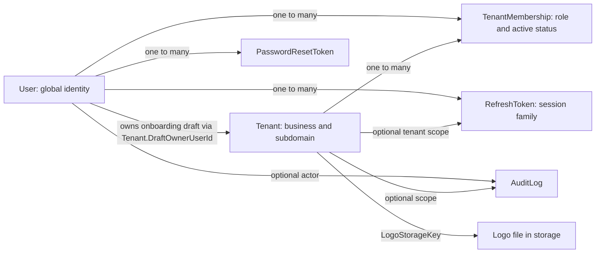

# Module 2: Identity, Onboarding and Tenancy

## Current system

Checked against the repository on 14 October 2026:

- .NET 10 layered monolith: Api, Application, Domain and Infrastructure; SDK 10.0.201 in `global.json`.
- Mediator, FluentValidation, Problem Details, Serilog and health endpoints are configured.
- PostgreSQL 17 and one EF Core `AppDbContext`; no business entities or migrations.
- `ICurrentUser` and `ITenantContext` are contracts without implementations.
- Three React/TypeScript workspace shells; pages are placeholders and API/time helpers are duplicated.
- Nginx accepts localhost, 127.0.0.1 and `johnfashion-001.localhost`; database tenant resolution is absent.
- xUnit, PostgreSQL Testcontainers and frontend Vitest tests exist. This document does not claim they were rerun.

## Scope

Implement identity, tailor/customer account registration, four-step business onboarding, tenant creation, logo storage, hostname resolution and tenant isolation across API, database and React.

Defer catalog, customer profiles/addresses, measurements, orders, payments, production, branches, staff invitations, subscriptions and management dashboards. Admin receives separate login and a protected placeholder only. Do not seed demo tenants.

## Main entity connections

The following entities are planned for Module 2; they do not exist yet.

`TenantMembership` uniquely joins one user and one tenant. Roles: TenantOwner, TenantManager, TenantStaff and Customer. PlatformAdmin belongs to the global user and is authorized separately. Draft ownership is an onboarding authorization link; it does not grant access to an active tenant.

## Implementation rules

1. Preserve working Module One code and follow `docs/coding-standards.md`. Keep Domain framework-independent, use cases/validators/contracts in Application, persistence/integrations in Infrastructure and HTTP composition in Api. Use thin Mediator endpoints and response DTOs.
2. Continue with PostgreSQL. Add `InitialIdentityAndTenancy`, with EF configurations in Infrastructure. Apply migrations through a documented deployment command/script, never API startup.
3. Use one global User with a unique normalized email. Store password hash, security stamp/version, active status and lockout state. Customers gain a Customer membership on the tenant where they register; existing accounts must authenticate before adding another membership.
4. Store Tenant business/contact/address fields, branding, status, onboarding step, draft owner, timestamps and a portable concurrency token. Add unique subdomain and `(TenantId, UserId)` membership constraints. Enforce one unfinished draft per user and foreign keys for the connections above.
5. Store only hashes of refresh/reset tokens, with expiry and revocation/use state. Refresh tokens also track family, replacement and authentication scope. Audit registration, login outcomes, password changes, tenant creation and deactivation without secrets.
6. Hash passwords through an Application abstraction backed by ASP.NET Core PasswordHasher; rehash on login when needed. Require at least 7 characters, permit at least 128, reject common passwords, throttle failures and return generic login/forgot-password responses.
7. Use 15-minute JWT access tokens in React memory and rotating opaque refresh tokens of at least 256 bits in host-only HttpOnly, Secure, SameSite cookies. Detect reuse and revoke the family. Configure issuer, separate tenant/platform-owner/admin audiences, signing secret, lifetime and clock skew. Validate user/membership status and security version on protected requests and refresh; revoke sessions on reset/deactivation and other sessions on password change.
8. Platform-owner authentication permits onboarding and listing the user's businesses. After redirecting to a tenant host, require login there to obtain that host's tenant-bound session. Never transfer tokens through URLs or share cookies across subdomains. Admin login uses a separate endpoint/audience; provisioning is guarded, explicitly configured and has no default credentials.
9. Protect refresh/logout with SameSite cookies, a required custom header and exact configured-origin validation. Keep CORS explicit and same-origin routing by default. Use HTTPS for cookie-based local verification; document local TLS setup.
10. Resolve tenants only from the accepted request hostname. Preserve trusted proxy rules and ignore `X-Forwarded-Host`. Platform hosts yield no tenant; valid subdomains resolve only active tenants. Return 404 for unknown/incomplete and 403 for suspended/deactivated tenants. Bound positive/negative caches and invalidate after changes.
11. Replace fixed gateway/API host allowlists with configured platform/wildcard rules plus strict hostname validation. A wildcard does not establish tenant existence. Reject a tenant JWT whenever its tenant claim differs from the resolved host.
12. Tenant-owned data uses `ITenantOwned`, EF query filters, explicit handler authorization/predicates, write guards and scoped constraints/composite foreign keys where required. Never select a tenant from a client-supplied ID. Platform onboarding is the explicit exception to hostname tenant context: find the draft through the authenticated user's ownership link.
13. Generate lowercase ASCII slug bases by Unicode normalization, diacritic removal, replacing `&` with `and`, collapsing separators and enforcing meaningful length. Generate the address from the saved business name without an automatic suffix or tenant-editable slug. The entire DNS label is at most 63 characters. Reject reserved names and occupied addresses; ask for a more distinctive business name. Enforce uniqueness with the database index, including concurrent launches. Active subdomains are immutable.
14. Provide `IFileStorage` and local storage outside the web source tree, with a Docker volume and server-generated keys. Accept decoded PNG/JPEG/WebP only; reject SVG, empty/invalid files, oversized files and excessive dimensions. Re-encode to remove metadata. Authorize draft-owner or active-owner uploads, clean up failed/replaced objects and expose public logos only for active tenants with safe response/cache headers.
15. Use TimeProvider for UTC instants and existing Africa/Lagos helpers for presentation. Keep provider-specific behavior in Infrastructure. Never log passwords, tokens, hashes or request bodies.

## Onboarding and API

Register a tailor on the platform host, then log in. Save a resumable draft linked to that user on the first business save. Wizard: **Business information → Branding/logo → Subdomain → Confirmation**.

Completion validates all steps and atomically assigns the subdomain, activates the tenant, creates its TenantOwner membership and records an audit entry. Invalidate the tenant cache after commit. Double-submit is idempotent. Allow multiple owned businesses, but only one unfinished draft per user. Return website/backoffice URLs with “Your TailorSpadi website is ready.”

| Area | Endpoints | Access |
| --- | --- | --- |
| Registration | `POST /api/auth/register-tailor`, `POST /api/auth/register-customer` | Platform / active tenant respectively |
| Sessions | `POST /api/auth/login`, `/refresh`, `/logout`; `GET /api/auth/me` | Scope to current host/session |
| Passwords | `POST /api/auth/forgot-password`, `/reset-password`, `/change-password` | Change requires authentication |
| Admin | `POST /api/admin/auth/login` | Platform host; separate admin audience/session |
| Draft | `GET /api/onboarding`; `PUT /api/onboarding/business`, `/branding` | Authenticated platform owner; own draft |
| Draft actions | `POST /api/onboarding/logo`, `/subdomain/preview`, `/complete` | Same draft ownership rules |
| Tenant | `GET /api/tenant/current` | Public, resolved active tenant; public fields only |

Add authorized activation/deactivation commands and only the endpoints needed by these screens. Define a static role/permission catalog with `ManageBusiness`; defer permission-management UI. Rate-limit auth and slug endpoints, with stricter login/reset/registration limits. Use single-use expiring reset links through `IEmailSender`; log messages only in Development and defer real delivery to Module 7.

## Frontend and routing

- Platform backoffice shell: `/register`, `/login`, `/forgot-password`, `/reset-password`, protected `/onboarding`.
- Tenant backoffice shell: `/login`, `/forgot-password`, `/reset-password`, protected `/backoffice`.
- Tenant storefront shell: `/register-customer` and `/customer/login`; customer recovery can use the tenant recovery routes above. Route these paths consistently in Nginx and React.
- Platform admin shell: `/admin/login` and a protected placeholder.
- Add React Hook Form, field/server errors, accessible labels, loading states, logo/color preview, debounced slug checks and saved wizard progress.
- Share API client, in-memory session/refresh queue and route guards through a small workspace package; move duplicated time helpers if straightforward. Use TanStack Query for server state. Never persist credentials in browser storage; remove reset tokens from the address bar after reading.

## Verification and handoff

- Test registration normalization, login/lockout, password rules, session rotation/reuse/logout, reset expiry/single use and deactivation revocation.
- Test resumable/idempotent onboarding, concurrent slug allocation, reserved/malicious hosts, tenant cache invalidation and safe logo uploads.
- With real PostgreSQL, prove cross-tenant reads/writes and token use are denied, admin authorization is separate, constraints prevent invalid relationships and the migration applies to an empty database without pending model changes.
- Test forms, wizard resume, role/tenant guards and concurrent refresh queueing. Preserve system-info without database/tenant, liveness during database failure and readiness returning 503.
- Run locked .NET restore, warnings-as-errors build, format check, unit/integration tests, `npm ci`, workspace builds/tests and vulnerability checks. Pin new dependencies and record exact versions/results.
- Update Compose, wildcard gateway routing, storage/JWT configuration, `.env.example`, local initialization and route verification scripts. Production must reject missing/weak signing secrets; never commit or print credentials.
- Update README and architecture/versions/verification docs after implementation. Document the host login handoff, CSRF, local TLS, migration commands and deferred decisions. Report changes and actual test results concisely.
